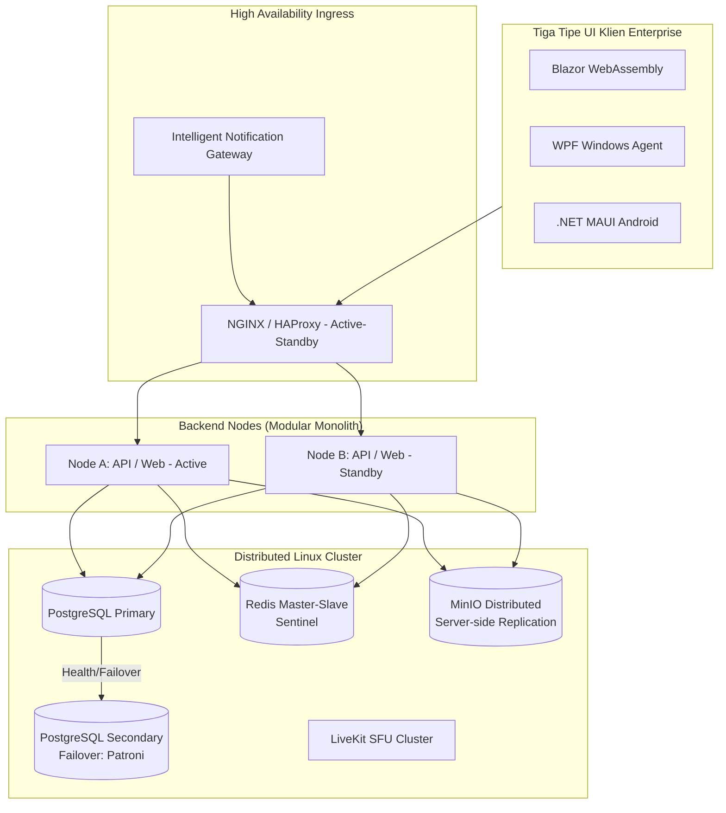

# PRD — Project Requirements Document

## 1. Overview
Karyawan perusahaan saat ini menghadapi kendala efisiensi akibat penggunaan aplikasi yang terpisah dan terfragmentasi. Komunikasi harian, file sharing, pengumuman perusahaan, manajemen proyek, hingga persuratan internal ditangani oleh beberapa platform (seperti MS Teams, Slack, Outlook, Monday.com, dan folder bersama yang berbeda). Hal ini mengakibatkan informasi mudah terlewat, file sulit ditemukan, notifikasi tidak konsisten, dan kelelahan mental akibat harus terus berpindah aplikasi.

**IPop (Integrated Portal for Operational Performance)** adalah sebuah platform komunikasi dan kolaborasi enterprise "All-in-One". IPop bertujuan menggantikan perangkat lunak pihak ketiga yang terpecah-pecah tersebut dan menyediakan satu pintu masuk terpusat untuk segala aktivitas operasional, komunikasi masa nyata, manajemen pekerjaan, dan penyebaran informasi perusahaan dengan keamanan yang terjamin.

## 2. Requirements
- **Platform Multi-Klien:** Aplikasi harus tersedia melalui peramban web (Blazor WebAssembly), aplikasi desktop dengan sinkronisasi lokal (WPF Windows Agent), dan perangkat seluler (Android menggunakan .NET MAUI).
- **Desain Enterprise & Visual:** Antarmuka harus fungsional dan serius—layout dengan _sidebar_ kiri memuat menu sederhana. Dilarang menyertakan elemen pemasaran, pahlawan khusus (_hero section_), judul _gimmick_, kartu dekoratif, atau gradasi warna berlebihan. **Standarisasi Visual:** Menggunakan library icon profesional (Lucide Enterprise/FontAwesome Pro). Dilarang keras menggunakan emoji di seluruh sistem UI/UX; reaksi chat menggunakan set sticker/icon resmi perusahaan.
- **Kesiapan Produksi & Skalabilitas (Enterprise-grade):** Sistem dirancang sebagai *Modular Monolith* dengan *Clean Architecture*. Wajib mengimplementasikan *outbox pattern*, *idempotency*, versi API, RBAC, *audit logging*, dan pemantauan. 
- **Infrastruktur High Availability (HA):** Deployment pada cluster Kubernetes/Linux dengan model *Node-per-Node*. Node API/Web dikonfigurasi *Active-Passive* (Node A Active, Node B Standby). Database PostgreSQL menggunakan *Primary-Secondary* dengan failover otomatis (Patroni). Redis menggunakan *Master-Slave* dengan *Sentinel*. MinIO menggunakan *Distributed Mode* dengan *server-side replication*.
- **Gateway Notifikasi Eksternal:** Selain notifikasi internal aplikasi, sistem bertindak sebagai "Intelligent Notification API Gateway" yang dapat digunakan oleh seluruh aplikasi internal perusahaan lain.

## 3. Core Features

### Antarmuka Pengguna & Aksesibilitas [medium]
- **Sistem Ikon Enterprise:** Seluruh antarmuka wajib menggunakan set ikon profesional terstandarisasi (Lucide Enterprise / FontAwesome Pro). Dilarang menggunakan emoji di level UI/UX; reaksi pada chat dan komentar menggunakan stiker/ikon resmi perusahaan.
- **Aksesibilitas (WCAG 2.1 AA):** Skema warna dengan kontras yang memadai (rasio minimal 4.5:1), dukungan navigasi keyboard penuh, label ARIA, dan pengaturan teks yang mudah dibaca.
- **Konsistensi Visual:** Tidak ada elemen pemasaran, hero section, tajuk gimmick, atau kartu dekoratif. Layout menggunakan sidebar kiri dengan menu sederhana.

### Keamanan & RBAC (Enhanced) [high]
- **Hierarchical RBAC:** Implementasi peran bertingkat di mana Role tertentu mewarisi *permission* dari Role di bawahnya secara otomatis. Warisan izin berlaku dari level Departemen ke Sub‑departemen; namun, izin spesifik dapat di‑override di level Pengguna (User Override) untuk fleksibilitas penuh tanpa mengubah struktur organisasi.
- **Contextual Permissions:** Validasi izin berdasarkan konteks data. Contoh: Pengguna hanya dapat mengedit delegasi tugas jika memiliki peran *Project Manager* di departemen yang memiliki proyek tersebut.
- **Device Fingerprinting:** Pada login dari Windows Agent dan aplikasi Android, sistem merekam sidik jari perangkat (kombinasi OS version, hardware hash, dan network fingerprint) untuk mendeteksi akses dari perangkat tidak dikenal dan memicu verifikasi tambahan atau pemblokiran.
- **Ghost Mode Audit Trail:** Mekanisme pemantauan pasif untuk mendeteksi dan mencatat akses terhadap data sensitif (*read-only access*) tanpa memerlukan perubahan data, guna mencegah kebocoran informasi internal. Seluruh log operasi administratif bersifat **immutable** (tidak dapat dihapus atau diubah) dan menggunakan deteksi anomali otomatis.
- **Resilience:** Penerapan *Circuit Breaker* manual per modul untuk melakukan isolasi modul yang bermasalah (misal: modul Panggilan sedang *high-load*) agar tidak mengganggu stabilitas modul lainnya dalam monolith.

### Masuk & Profil [high]
- **Otentikasi Primer:** Menggunakan nomor HRIS/NIK dan kata sandi awal “1234”; validasi terhadap HRIS Gateway.
- **Alur Login Pertama:** Validasi ke HRIS Gateway → ambil data pegawai → buat/perbarui akun lokal → deteksi login pertama → wajib ubah kata sandi (blokir fitur lain) → hash via Argon2 → audit log. Saat penggantian kata sandi paksa, seluruh sesi aktif di perangkat lain otomatis diakhiri (global session invalidation) untuk memastikan keamanan kredensial baru.
- **Integrasi HRIS:** Antarmuka `IHrisGateway` dengan adaptor Development, Production, Mock, serta sinkronisasi inkremental terjadwal.
- **Keamanan Sesi:** Access token JWT, refresh-token rotation, daftar perangkat aktif, force logout, rate limiting (5 kali gagal), temporary lockout, secret management (Key Vault), serta circuit breaker untuk API eksternal. Penerapan device fingerprint pada setiap permintaan token untuk mendeteksi anomali perangkat.

### Chat [high]
- **Infrastruktur Real-time:** SignalR dengan Redis backplane. Otorisasi hub, payload limit, reconnect, missed-event recovery, dan idempotency key.
- **Fitur Pesan:** 1-on-1 dan grup. Pengiriman, edit, hapus, reply, quote, forward. Pin pesan, lampiran (media/dokumen preview), typing indicator, presence status, status pengiriman (terkirim/dibaca), draft, dan pencarian.
- **Emergency Broadcast:** Admin atau pemilik grup khusus dapat mengirim pesan siaga darurat yang menembus pengaturan Mute seluruh anggota; pesan tersebut dilengkapi notifikasi prioritas dan ikon khusus tanpa mengabaikan kebijakan ikon perusahaan.
- **Reaksi & Sticker:** Menggunakan koleksi icon resmi perusahaan (bukan emoji standar).
- **Ketahanan:** Antrean offline dan auto-retry dengan pengecekan idempotensi di sisi server.
- **Manajemen Grup:** Owner/Admin, manajemen anggota, mute, arsip, panggilan grup, dan log riwayat anggota.

### Panggilan [medium]
- **Infrastruktur:** WebRTC (media), SignalR (signaling/invitation), LiveKit self-hosted (SFU), serta STUN/TURN server internal.
- **Fitur Utama:** Voice call, Video call (1-on-1 & Grup maks 6), Screen sharing, Mute, Pemilihan perangkat (mic/speaker), Active speaker, participant list, call history, dan network quality indicator.
- **Keamanan:** Setiap room dilindungi *short-lived token* dan otorisasi berdasarkan daftar peserta yang sah.

### Surat [high]
- **Manajemen:** Kotak Masuk, Terkirim, Draft (auto-save), Berbintang, Arsip, Sampah.
- **Penyusunan:** To, CC, BCC, Rich Text Editor, Attachment, Threading (replies).
- **Produktivitas:** Status delivery/read, Tanda tangan & Paraf elektronik, Cetak & Ekspor PDF.
- **Model Data:** Tabel relasional `MailRecipients` untuk manajemen multi-penerima yang efisien.

### Berita & Memo [medium]
- **Konten:** Berita korporat, Pengumuman, dan Memo.
- **Workflow:** Approval sistem sebelum publikasi. Penjadwalan, Target audiens (Dept/Role/Individu), Pin konten, dan *Mandatory Acknowledgement* (Konfirmasi Baca Wajib).
- **Kepatuhan:** Audit trail lengkap untuk setiap perubahan konten.

### Proyek [medium]
- **Manajemen:** Grouping by Year, Owner/Members, Timeline (Start/Deadline), Status, Progress, Risk/Obstacle Tracking.
- **Tampilan:** Kanban (To-Do, Doing, Done), List, Timeline (Gantt), Calendar, Workload.
- **Analisis Jalur Kritis:** Pada tampilan Timeline (Gantt), sistem secara otomatis menghitung dan menampilkan *Critical Path* proyek untuk mengidentifikasi tugas‑tugas yang paling berpengaruh terhadap tenggat proyek secara keseluruhan.
- **Detail Tugas:** Subtasks, PIC (Multi-assignee), Priority, Dependency, Time tracking (Estimate vs Actual), Recurring tasks, dan template proyek.
- **Real-time:** Sinkronisasi status board secara instan via SignalR.
- **Reporting:** Export PDF/Excel untuk metrik progress, timeline, dan aktivitas.

### File Terpusat [high]
- **Backend:** MinIO (Distributed Clustered Mode) untuk penyimpanan, PostgreSQL untuk metadata, integrasi Malware Scanning.
- **Fitur:** Upload/Download (Pause, Resume, Retry), Progress, Versioning, Duplicate detection (Hash-based), Permission RBAC, Signed URL.
- **Windows Agent:** Aplikasi WPF (System tray, Native toast, Auto-start). Sinkronisasi folder lokal khusus, selective sync, offline queue, deep link `ipop://`, enkripsi DPAPI.
    - **Integrasi SSO:** Dukungan Single Sign-On (SSO) jika mesin Windows telah bergabung dengan domain Active Directory perusahaan; autentikasi otomatis dengan token yang diperoleh dari sinkronisasi HRIS.
    - **Smart Sync:** Fitur sinkronisasi cerdas di mana file hanya diunduh saat dibuka (on‑demand), menghemat ruang disk lokal dan menampilkan placeholder di File Explorer.
- **Integrasi:** Layanan tunggal untuk seluruh modul (Chat, Surat, Proyek, dll).

### Direktori [medium]
- **Visual:** Daftar flat seluruh karyawan dengan pencarian (nama/NIK) dan live presence. Tidak ada grouping — assignment department/site adalah milik admin (lihat Administrasi), bukan HRIS.
- **Profil:** HRIS ID, Nama, Foto, Jabatan, Dept (admin-assigned), Site (admin-assigned), Ekstensi, Lokasi, Presence.
- **Aksi Cepat:** Tombol cepat Chat, Surat, dan Panggilan langsung dari profil.

### Intelligent Notification Gateway [high]
- **Gateway Tunggal:** Endpoint API bagi aplikasi internal (HRIS, ERP, CRM, dll) untuk mengirim notifikasi terpusat.
- **Intelligent Routing:** Sistem secara otomatis mendeteksi kanal pengiriman tercepat: Menggunakan SignalR/Windows Toast jika user online di desktop/web, dan beralih ke FCM/Push Notification jika user offline.
- **Keamanan Client:** Client ID/Secret, Allowed IP, Allowed Event Types, Rate Limiting, Secret Rotation, OAuth 2.0/HMAC.
- **Prioritas Antrean:** Dukungan *Priority Queuing* — notifikasi dengan prioritas tinggi (misal, darurat atau kepatuhan) langsung diproses lebih dahulu, sementara notifikasi massal (bulk) dimasukkan ke antrean reguler untuk menjaga performa sistem.
- **Targeting:** Employee ID, Dept, Role, atau All Users.
- **Reliability:** Outbox Pattern, Asynchronous Delivery, Retry Mechanism (Exponential Backoff), Dead-Letter Queue, Webhook Callback (HMAC signed).
- **Status Lifecycle:** `Accepted`, `Queued`, `Processing`, `Delivered`, `Read`, `Acknowledged`, `Failed`.

### Administrasi [low]
- **Pengelolaan:** User management (tambah/edit/nonaktifkan/reset password ke flow default), Hierarchical Role & Permission management (assign Admin/Employee, self-lockout guard), Session monitor (revoke saat deactivate), HRIS sync monitor dengan tombol **Sync now** (karyawan baru otomatis masuk; department & site tidak disentuh HRIS).
- **Organization:** Department dan Site dibuat/dikelola sepenuhnya oleh admin (CRUD + activate/deactivate) dan di-assign manual per user. HRIS sync hanya menarik profil karyawan — koreksi admin (`IsManuallyEdited`) tidak ditimpa sync berikutnya.
- **Audit:** Dashboard audit trail terpusat termasuk Ghost Mode logs. Seluruh log operasi administratif bersifat immutable dan dapat ditampilkan secara real-time.
- **Operasi High Availability:** Panel monitoring menampilkan status node aplikasi (Active‑Passive) dengan health check otomatis melalui Load Balancer Nginx/HAProxy. Menampilkan replikasi PostgreSQL (Streaming Replication) dengan status Primary‑Secondary serta koneksi PgBouncer untuk connection pooling. Memantau kluster MinIO (Distributed Mode) dan Redis (Sentinel/Master‑Slave). Kemampuan failover manual atau otomatis sesuai kebijakan.

### Aplikasi Android (.NET MAUI) [medium]
- **Navigasi:** Tab Bar (Beranda, Chat, Surat, Proyek, Lainnya).
- **Fitur Mobile:** Push Notification interaktif (FCM), Offline cache via SQLite, Biometric/Keystore untuk login aman, WorkManager untuk background sync.
- **Sinkronisasi:** Pesan, draf, dan file diunggah secara idempotent saat koneksi pulih setelah kondisi offline.
- **Keamanan Perangkat:** Login dilengkapi device fingerprint untuk mendeteksi akses dari perangkat tidak dikenal dan memicu verifikasi biometrik tambahan.

## 4. User Flow
1. **Otentikasi:** Pengguna masuk, sistem mengecek role dan jabatan secara kontekstual melalui mekanisme Hierarchical RBAC.
2. **Dashboard:** Menampilkan notifikasi cerdas yang telah dirutekan oleh gateway.
3. **Kolaborasi:** Pengguna mengelola proyek, file tersinkronisasi otomatis antara WPF Agent dan MinIO Cluster.
4. **Komunikasi:** Panggilan video dilakukan melalui LiveKit SFU dengan proteksi token berdurasi singkat.
5. **Auditing:** Seluruh akses terhadap data strategis dicatat oleh Ghost Mode Audit Trail tanpa mengganggu performa.

## 5. Architecture

## 6. Database Schema
PostgreSQL dengan skema modular. Tabel utama: `Users`, `Roles` (hierarchical_link), `Permissions`, `ContextualRules`, `Messages`, `Mails`, `MailRecipients`, `Projects`, `Tasks`, `Files` (checksum_hash), `Notifications`, `NotificationDeliveries`, `AuditLogs` (termasuk ghost_access_flag).

## 7. Tech Stack
- **Framework:** .NET 10 (ASP.NET Core, Blazor WASM, MAUI, WPF).
- **Database:** PostgreSQL (High Availability Cluster).
- **Cache & Real-time:** Redis (Sentinel), SignalR.
- **Media:** WebRTC + LiveKit (SFU).
- **Storage:** MinIO (Distributed Mode).
- **Icons:** Lucide Enterprise / FontAwesome Pro.
- **Ops:** Docker, Kubernetes, Linux (Ubuntu/Alpine).
- **Resilience:** Polly (Circuit Breaker per modul).